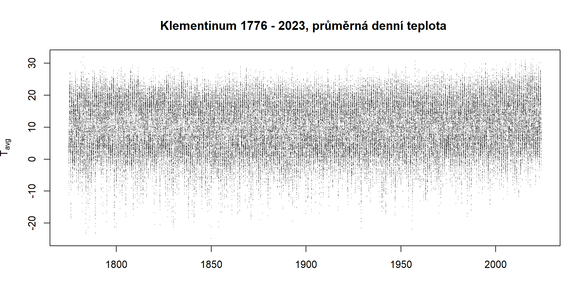

# Rozdělení extrémních hodnot {#sec-rozdeleniextremnichhodnota}

V hydrologii a klimatologii se často nezajímáme o „běžné“ hodnoty nějaké veličiny, ale o její extrémy – například *maximální* měsíční teploty, *nejvyšší* intenzitu srážek nebo *minimální* průtok v letním období. K jejich popisu se používá teorie rozdělení extrémních hodnot (*Extreme Value Theory*, zkr. EVT).

Základní myšlenkou je studium chování maxim (případně minim) náhodného výběru místo samotné distribuční funkce původních dat.

K podchycení výskytu extrémních hodnot je třeba 

```{r, echo=FALSE, eval=TRUE}
klementinum <- readRDS("data/klementinum.rds")
klementinum$date <- as.POSIXct(paste(klementinum$yr, 
                             sprintf(fmt = "%02d", klementinum$mon),
                             sprintf(fmt = "%02d", klementinum$day),
                       sep = "-"), tz = "CET", format = "%Y-%m-%d")

threshold <- quantile(x = klementinum$tavg, 
                      probs = c(0.98, 0.02))

klementinum_plot <- subset(klementinum, yr > 1899 & yr < 2001)
```


## Vymezení extrémní hodnoty

Jak poznat jaká hodnota je extrémní? Ne každá vysoká či nízká hodnota je extrém. Extrém je definován výběrem, není to tedy vlastnost hodnoty, ale způsobu stanovení.\

Na výskyt extrémních hodnot už jsme narazili u Poissonova či Binomického rozdělění.
Vzhledem k tomu, že návratové hodnoty $Q_{1000}$, $Q_{10\:000}$, nepřekvapí, že zcela zásadní jsou data. 

### Bloková maxima

### Překročení limitu

Z dat jsou užita pouze pozorování překračující stanovenou mez, například 95 % kvantil.

::: callout-tip
## Úloha

1.  

    a)  Nahrajte do prostředí data z klementiské řady měření
    b)  Metodou blokových maxim stanovte maxima
:::


```{r, echo=FALSE, eval=TRUE}
#| fig.cap: "Časová řada měřených průměrných denních teplot v pražském Klementinu v rozsahu let 1900-2000."
#| out.align: "center"
plot(x = klementinum_plot$date, 
     y = klementinum_plot$tavg, 
     type = "p", 
     cex = 0.1, 
     col = "#00000050", 
     ylab = expression(italic(T)[avg]), 
     xlab = "")
# rect(xleft = min(klementinum$date), 
#      xright = max(klementinum$date), 
#      ytop = threshold[1], 
#      ybottom = threshold[2], 
#      col = "#ffffffee", 
#      border = "#ffffff")
# abline(h = threshold, 
#        col = "red", 
#        lwd = 2)
```



```{r}
#| out.align: "center"
#| echo: false
blocks <- subset(klementinum_plot, yr %in% 1991:1995 & mon %in% c(6, 7, 8))

block_xmin <- aggregate(date ~ mon + yr, FUN = min, data = subset(blocks, mon == 6))$date
block_xmax <- aggregate(date ~ mon + yr, FUN = max, data = subset(blocks, mon == 8))$date


plot(x = subset(klementinum_plot, yr %in% 1991:1995)$date, 
     y = subset(klementinum_plot, yr %in% 1991:1995)$tavg, 
     type = "p", 
     cex = 0.25, 
     col = "#00000090", 
     ylab = expression(italic(T)[avg]), 
     xlab = "")
rect(xleft = block_xmin,
     xright = block_xmax,
     ytop = max(klementinum_plot$tavg),
     ybottom = min(klementinum_plot$tavg),
     col = NA,
     border = "red")

```


```{r}
#| fig.cap: "Klementinum 2000-2020. Identifikace extrémů s pomocí 'Peak-over-threshold'."

klementinum_short <- klementinum |> 
  dplyr::filter(yr %in% 2000:2020) 
window <- 2000:2020


i <- seq(from = as.Date("2000-01-01"), to = as.Date("2020-12-31"), by = "1 year")
j <- ifelse(as.numeric(i) %% 2 == 0, "black", "#00000090")

plot(x = klementinum_short$date,
     y = klementinum_short$tavg, 
     type = "p", 
     cex = 0.1, 
     col = "#00000050", 
     ylab = expression(italic(T)[avg]*degree*C), 
     xlab = "")
## draw rectangles with bottom left (100, 300)+i
## and top right (150, 380)+i
rect(0+i, 365+i, -10, 20, col = j, 
     border = j)
abline(h = threshold, 
       col = "red", 
       lwd = 2)
```

## Gumbellovo rozdělení

Hustota funkce Gumbellova rozdělení je dána předpisem

$$
f(x) = \dfrac{1}{d}\exp\left(-\dfrac{x-c}{d}\right)\cdot\exp\left[-\exp\left(-\dfrac{x-c}{d}\right)\right]
$$ kde $c$ a $d$ jsou parametry. Kvantilová funkce je pak $$
x_T = c - d\cdot\ln\left[-\ln\left(1-\dfrac{1}{T}\right)\right]
$$

kde $T$ je doba opakování a parametry odhadnuté metodou mometů jsou:

$$
d = \dfrac{\sqrt{6}}{\pi}\sigma, \quad c = \mu-0.5772\cdot d
$$

a $\mu$ $\sigma$ jsou momenty celkového souboru.

```{r, fig.align='center'}
fitgumbel <- function(x, ...) {
  mX <- mean(x)
  sdX <- sd(x)
  dX <- sqrt(6)/pi*sdX
  cX <- mX - 0.5772*dX
  curve(cX - d*log(-log(1-1/x)), add = TRUE, ...)
}

plot(x = c(1,100), 
     y = c(0,100), 
     type = "n", 
     xlab = "Doba opakování (roky)", 
     ylab = "Maximální denní průtok v roce (mm/d)")
# fitgumbel()
```
